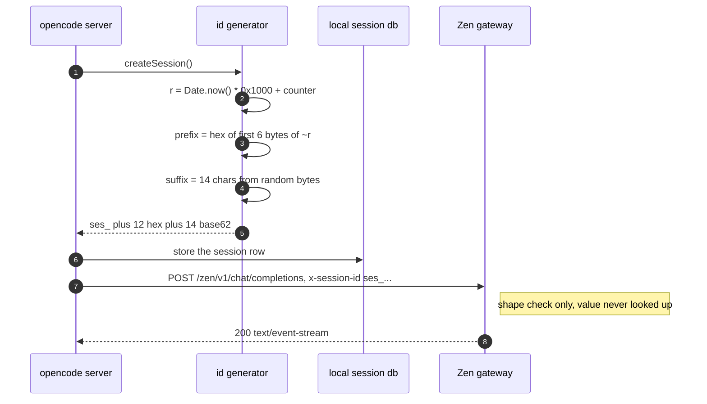
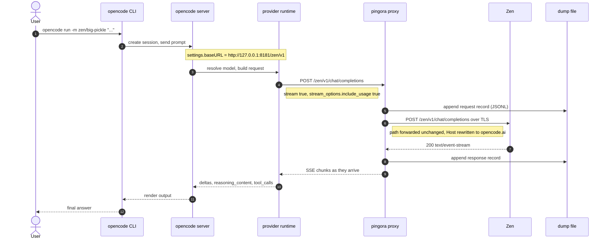
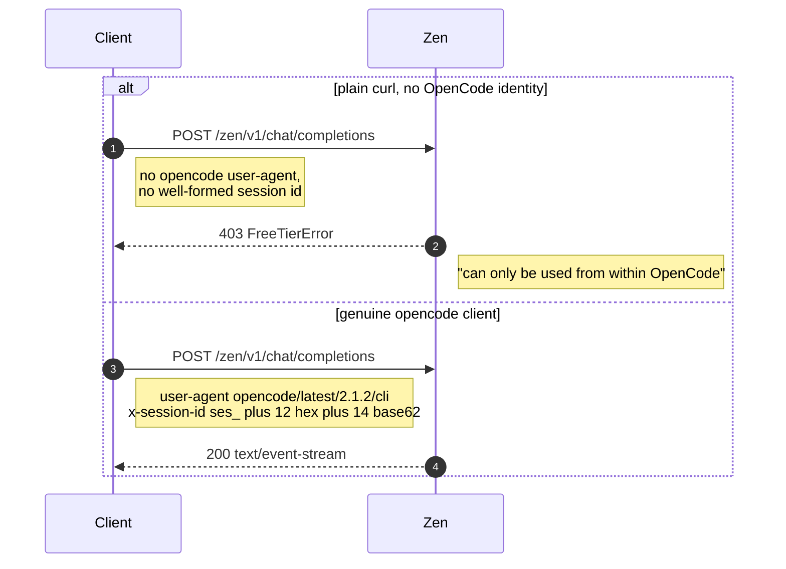
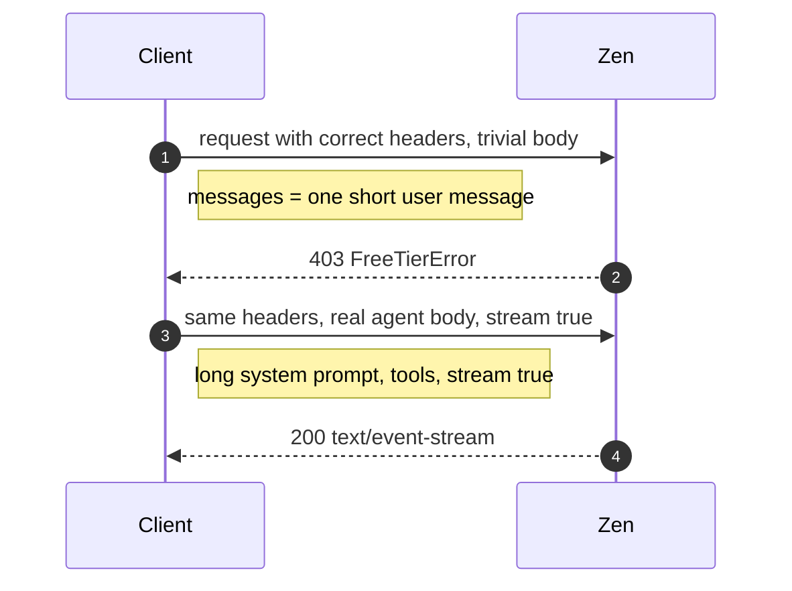
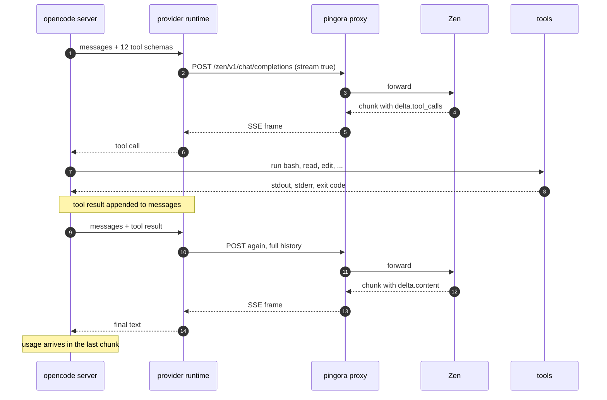
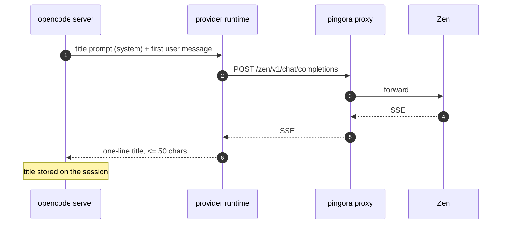
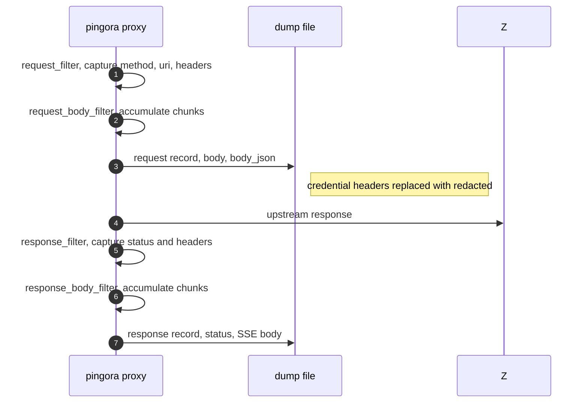

# OpenCode Zen API — research notes

Notes gathered on 2026-10-22 while wiring `opencode` through the
[pingora reverse proxy](./README.md) in this repo to reach
`https://opencode.ai/zen/v1/chat/completions`.

Everything below was verified against the live endpoints. Where a statement
comes from black-box probing rather than a published spec, it says so; where
it comes from the opencode binary itself, the code is quoted.

---

## 1. Endpoints

The Zen gateway serves an OpenAI-compatible API. Paths are forwarded
unchanged, so any of these can be proxied by pointing the upstream at
`opencode.ai:443` with TLS.

| Endpoint | Purpose |
| --- | --- |
| `https://opencode.ai/zen/v1/chat/completions` | Chat completions (OpenAI-compatible, SSE streaming) |
| `https://opencode.ai/zen/v1/models` | Model list (86 models at the time of writing) |
| `https://opencode.ai/inference/v1/models` | Full model list with metadata |
| `https://opencode.ai/inference/openai/v1/chat/completions` | Console (pay-as-you-go) chat completions |
| `https://opencode.ai/inference/openai/v1/responses` | Console Responses API (GPT, Grok, Muse) |
| `https://opencode.ai/inference/anthropic/v1/messages` | Console Anthropic Messages API (Claude, Qwen) |
| `https://opencode.ai/inference/google/v1beta/models/{model}` | Console Gemini API |
| `https://opencode.ai/inference/systemone/v1/systemone` | Console Jev structured-decision API |

`/zen/v1` and `/inference/.../v1` are aliases for the same backend; both
returned identical model catalogs. `/zen/v1` is the shorter, current form.

## 2. Model catalog

`GET /zen/v1/models` returns an OpenAI-style list:

```json
{"object":"list","data":[{"id":"big-pickle","object":"model","created":1792669362,"owned_by":"opencode"}]}
```

Free models (usable without an account): `big-pickle`, `beam-free`,
`flint-40b-free`, `glm-5.3-flash-free`, `minimax-m3.1-flash-free`,
`mimo-v2.6-flash-free`, `nemotron-3.5-lightning-free`,
`nemotron-3.5-super-vl-free`, `deepseek-v4.1-flash-free`,
`jem/jev-1.13-free`, `longcat-2.5-preview-free`, `exo-free`.

Paid models require an `OPENCODE_API_KEY` from <https://opencode.ai/console>.
Pricing is per 1M tokens; `big-pickle` is currently free.

The catalog itself is published by models.dev — the `opencode` provider entry
is:

```json
{ "id": "opencode", "env": ["OPENCODE_API_KEY"],
  "npm": "@ai-sdk/openai-compatible",
  "api": "https://opencode.ai/inference/openai/v1" }
```

Fetch the raw catalog with `curl https://models.dev/api.json`.

## 3. Free-tier gating (the `403 FreeTierError`)

A bare `curl` against the free models gets:

```json
{"type":"error","error":{"type":"FreeTierError",
 "message":"OpenCode's free tier can only be used from within OpenCode. Download it at https://opencode.ai and keep building."}}
```

This is **not** an API-key check. Bisecting the headers of a real, working
`opencode` request with curl showed two conditions, both required:

1. `user-agent: opencode/latest/<version>/cli` — dropping it flips 200 → 403;
   any other header in the set is individually droppable.
2. `x-session-id` carrying a **well-formed** session id — dropping it flips
   200 → 403. The gateway checks the *shape* of the id, never its value
   (see [3.2](#32-what-the-gateway-actually-checks)).

Additional observations from the bisection:

- The request body has to look like real agent traffic. The captured
  title-generator request (2.4 KB, long system prompt, `stream: true`) is
  accepted; a body of `{"model":"big-pickle","messages":[{"role":"user","content":"hi"}]}`
  is rejected with 403 even with the full correct header set.
- `stream: false` on an otherwise valid request is also rejected.
- Setting `user-agent: opencode/...` but not `opencode/latest/<ver>/cli` is
  rejected, so the version segment matters.

Practical consequence: the free tier is not cryptographically gated, but it
does imitate the OpenCode client. A curl request gets through only if it
reproduces the header, a well-formed session id and a real agent body.

### 3.1 The session id is generated by the client

**No API hands out session ids.** The OpenCode server mints them locally,
stores them in its own database, and the gateway never sees a session
registry — it only ever sees the string in the `x-session-id` header.

The generator is in the opencode binary (`chunk-wy9a8t00.js`):

```js
var D = 26,
    F = "0123456789ABCDEFGHIJKLMNOPQRSTUVWXYZabcdefghijklmnopqrstuvwxyz",
    y = 0, d = 0;
function ff() { return QZ(!1) }   // every id kind except sessions
function Vde() { return QZ(!0) }  // session ids
function QZ(e, n = Date.now()) {
  if (n !== y) y = n, d = 0;
  d++;
  let r = BigInt(n) * 0x1000n + BigInt(d),  // ms timestamp << 12 | counter
      a = e ? ~r : r,                         // session ids are bit-inverted
      c = Array.from({ length: 6 }, (l, h) =>
            Number(a >> BigInt(40 - 8 * h) & 0xffn).toString(16).padStart(2, "0")).join(""),
      s = crypto.getRandomValues(new Uint8Array(D - 12));
  return c + Array.from(s, (l) => F[l % 62]).join("");
}
// a session id is "ses_" + Vde()
```

A session id is therefore `ses_` plus 26 characters:

| Part | Chars | Content |
| --- | --- | --- |
| timestamp prefix | 12 | big-endian hex of the first 6 bytes of `~(Date.now() * 4096 + counter)` — the client's own clock, inverted |
| random suffix | 14 | `0123456789A-Za-z`, one character per random byte via `F[byte % 62]` (so slightly non-uniform) |

The timestamp is recoverable from the prefix: invert the 6 bytes, drop the
low 12 bits (the per-millisecond counter) and you get the creation time in
milliseconds, modulo 2^36 ms (~2.2 years). Session ids are inverted
(`QZ(true)`) while every other id kind is not — which is why `ses_` ids end
in `ffe` and `msg_` ids end in `001` at counter 1.

Verified against the local session store
(`/root/.local/share/opencode/opencode.db`, table `session_v2`): every id in
it matches `ses_[0-9a-f]{12}[0-9A-Za-z]{14}`, and re-running the generator
around the stored `time_created` reproduces the recorded prefix exactly
(counter 1, timestamp within ~1.3 s of the stored value).



### 3.2 What the gateway actually checks

Every row is a live request to `https://opencode.ai/zen/v1/chat/completions`
with the captured agent body, `user-agent: opencode/latest/2.1.2/cli` and a
varying `x-session-id`:

| `x-session-id` | HTTP |
| --- | --- |
| `ses_` + 12 lowercase hex + 14 base62 | 200 |
| same, but the timestamp prefix decodes to 1970-01-01 | 200 |
| same, but the prefix decodes to one hour ago / one day ahead | 200 |
| `ses_` + 12 hex + 14 base62, with `-`, `_` or `.` in the tail | 403 |
| `ses_` + 12 hex + 12/15/16 base62 (suffix 24/27/28) | 403 |
| `ses_` + 12 hex and nothing else | 403 |
| `ses_` + 12 hex where one of the first 12 chars is `g` or uppercase | 403 |
| 26 base62 chars without the `ses_` prefix | 403 |

The rule the gateway applies is a plain shape check:

```
^ses_[0-9a-f]{12}[0-9A-Za-z]{14}$
```

The value of the timestamp prefix is not validated — a prefix that decodes
to 1970 is as good as one that decodes to now. The id is a client-side
artefact rather than a server-issued token, so there is nothing for the
gateway to look up.

## 4. OpenCode configuration (v2 schema)

The live schema is at <https://opencode.ai/config.json>. The v2 shape differs
from v1 in ways that silently break configuration.

### File locations and precedence

```
/etc/opencode/opencode.json                    # system, highest
~/.config/opencode/opencode.json               # user
<repo>/opencode.json  |  <repo>/.opencode/opencode.json   # project
```

Within a tree, `.opencode/` directories win over direct `opencode.json`
files. `opencode debug config` prints every config source that was loaded.

### The `providers` key

The key is `providers` (plural). Each entry is keyed by the provider id used
in `provider/model` references:

```jsonc
{
  "$schema": "https://opencode.ai/config.json",
  "model": "zen/big-pickle",
  "providers": {
    "zen": {
      "name": "OpenCode Zen (local proxy)",
      "package": "@opencode/ai/providers/openai-compatible",
      "settings": { "baseURL": "http://127.0.0.1:8181/zen/v1" },
      "models": {
        "big-pickle": {
          "name": "Big Pickle",
          "limit": { "context": 200000, "output": 64000 },
          "capabilities": {
            "tools": true,
            "input": ["text", "image"],
            "output": ["text"],
            "reasoning": { "supported": true }
          }
        }
      }
    }
  }
}
```

| Field | Meaning |
| --- | --- |
| `package` | Runtime package, e.g. `@opencode/ai/providers/openai-compatible` |
| `canonical` | Built-in provider id whose catalog defaults are inherited |
| `settings` | Package options — `baseURL`, `apiKey`, timeouts, `encoding`, `compaction`, `transport` |
| `headers` | Extra request headers (string values) |
| `body` | Extra JSON fields merged into every request body |
| `models` | Model overrides, keyed by the model id |

### Pitfalls found

- **`options` is not a valid key.** v1 used `provider.<id>.options`; v2 uses
  `providers.<id>.settings`. An unknown key is stripped, so the config looks
  correct in `opencode debug config` but the override never applies.
- **Malformed entries are dropped silently.** `opencode debug config` shows an
  empty `{}` for the provider and the server logs only
  `WARN configuration normalization diagnostic ... kind=invalid action="skipped malformed recognized value"`.
  Use `opencode models --standalone --print-logs --log-level debug` to see it.
  In this case the culprit was `capabilities.tool_call`; the schema wants
  `capabilities.tools`, and `capabilities.reasoning` is an object
  (`{"supported": true}`), not a boolean.
- **Overriding a built-in provider's `baseURL` does not work.** Setting
  `providers.opencode.settings.baseURL` is accepted and shown by
  `opencode debug config`, but requests still go to the catalog endpoint.
  Define a new provider id instead (this repo uses `zen`).
- **`canonical` alone is not enough.** `providers.zen.canonical = "opencode"`
  produced a provider with zero models. Listing the model explicitly is what
  makes it selectable.
- **The background server caches config.** `opencode run` talks to the
  already-running `opencode serve --service` process, which was started
  before the config file existed, so it kept using the old provider. Use
  `opencode run --standalone` for a fresh server, or `opencode service restart`.
- `settings.baseURL` is package-specific: it only has an effect when the
  selected package supports it.

### Useful CLI commands

```sh
opencode debug config                    # every config source, merged
opencode models                          # selectable provider/model pairs
opencode models --standalone             # ... in a fresh server
opencode run -m provider/model "prompt"  # non-interactive run
opencode service restart                 # restart the background server
opencode run --print-logs --log-level debug   # server logs on stderr
```

## 5. Observed wire format

Headers sent by `opencode` v2.1.2 (`user-agent: opencode/latest/2.1.2/cli`):

```
accept: */*
accept-encoding: gzip, deflate, br, zstd
b3: 28d53cc6-...-1-2408aec904781ae9
content-type: application/json
traceparent: 00-28d53cc6-...-01
user-agent: opencode/latest/2.1.2/cli
x-opencode-client: cli
x-opencode-project: <sha1 of the project>
x-opencode-session: ses_...
x-opencode-session-id: ses_...
x-session-affinity: ses_...
x-session-id: ses_...
```

Request body (title-generation call, 2.4 KB):

```json
{
  "messages": [ { "role": "system", "content": "You are a title generator. ..." },
                { "role": "user",   "content": "\"Reply with exactly: ...\"" } ],
  "model": "big-pickle",
  "stream": true,
  "stream_options": { "include_usage": true }
}
```

Request body (main agent call, 22 KB) adds `max_completion_tokens` and a
`tools` array of 12 function schemas (`edit, glob, grep, question, read,
shell, skill, subagent, webfetch, websearch, write, execute`).

Response is SSE (`content-type: text/event-stream`, `transfer-encoding: chunked`)
with `chat.completion.chunk` frames. Reasoning is returned in
`delta.reasoning_content`, not a separate event type. Zen adds an
`x-zen-model` response header and Cloudflare's `cf-ray`.

Usage arrives in the final chunk (`stream_options.include_usage`):
`{"usage":{"prompt_tokens":9303,"completion_tokens":266,"total_tokens":9569,
"prompt_tokens_details":{"cached_tokens":7818},
"completion_tokens_details":{"reasoning_tokens":171}}}`.

## 6. Proxying Zen through this repo

`conf-zen.toml` in this repo points the proxy at Zen:

```toml
[server]
listen = "127.0.0.1:8181"

[upstream]
host = "opencode.ai"
port = 443
tls = true

[dump]
file = "/tmp/opencode/zen-dump.jsonl"
max_body_bytes = 1048576
```

Start it and point `opencode` at it:

```sh
./run-zen.sh                 # 127.0.0.1:8181 -> https://opencode.ai
opencode run -m zen/big-pickle "hello"
```

The path is forwarded unchanged, so the client path `/zen/v1/chat/completions`
becomes `https://opencode.ai/zen/v1/chat/completions`.

Two build notes:

- Pingora's `openssl` feature must be enabled for TLS upstreams; with the
  default (empty) feature set, `https://` upstreams fail with `502`.
- Pingora binds with `SO_REUSEPORT`, so two proxy instances on the same port
  silently split traffic between them. Kill stale instances before restarting.

The `[dump]` section writes one JSONL record per request and per response,
including the full body — see the [Dump section of the README](./README.md).
For an agent that means the whole prompt and conversation history lands on
disk, so treat the dump file as sensitive.

## 7. Reproducing the findings

The two scripts behind this section are also checked in under
[`research/`](./research).

### 7.1 One-off checks

```sh
# model catalog
curl -s https://opencode.ai/zen/v1/models | jq '.data[].id'

# free tier gate: 403 FreeTierError
curl -s https://opencode.ai/zen/v1/chat/completions \
  -H 'content-type: application/json' \
  -d '{"model":"big-pickle","messages":[{"role":"user","content":"hi"}]}'

# through the proxy, with the body captured
curl -s http://127.0.0.1:8181/zen/v1/chat/completions \
  -H 'content-type: application/json' \
  -d '{"model":"big-pickle","messages":[{"role":"user","content":"hi"}]}'
jq -c 'select(.kind=="request") | {uri, body_bytes}' /tmp/opencode/zen-dump.jsonl
```

### 7.2 Probing the session-id shape

`research/probe-session-id.py` sends the captured agent body with a varying
`x-session-id` and prints the status code of each probe — the matrix behind
[3.2](#32-what-the-gateway-actually-checks).

```python
#!/usr/bin/env python3
"""Probe the Zen free-tier gate with different x-session-id shapes.

Every request uses the real agent body captured by the proxy in this repo,
so the only variable is the session id (or the missing header).

Usage:
    probe-session-id.py [dump-file]

The dump file is produced by the proxy (see conf-zen.toml); the first record
in it is the title-generator request, which the gateway accepts.
"""
import json
import secrets
import string
import subprocess
import sys
import time

DUMP = sys.argv[1] if len(sys.argv) > 1 else "/tmp/opencode/zen-dump.jsonl"
URL = "https://opencode.ai/zen/v1/chat/completions"
UA = "opencode/latest/2.1.2/cli"
B62 = string.digits + string.ascii_uppercase + string.ascii_lowercase

records = [json.loads(line) for line in open(DUMP)]
body = json.dumps(json.loads(records[0]["body"]))
real_id = records[0]["headers"]["x-session-id"]


def status(session_id=None, payload=body):
    """Return the HTTP status code of a probe request."""
    cmd = [
        "curl", "-sS", "-m", "90", "--compressed", "-o", "/dev/null",
        "-w", "%{http_code}", URL,
        "-H", "content-type: application/json",
        "-H", f"user-agent: {UA}",
    ]
    if session_id:
        cmd += ["-H", f"x-session-id: {session_id}"]
    cmd += ["-d", payload]
    return subprocess.run(cmd, capture_output=True, text=True).stdout.strip()


def prefix(now_ms, counter=1):
    """The 12 hex characters a real opencode session id starts with."""
    a = ~(now_ms * 0x1000 + counter)
    return "".join(f"{(a >> (40 - 8 * h)) & 0xff:02x}" for h in range(6))


def tail(count=14):
    """The 14 random base62 characters of a session id."""
    return "".join(secrets.choice(B62) for _ in range(count))


now = int(time.time() * 1000)
cases = [
    ("real captured id", real_id),
    ("no x-session-id header", None),
    ("ses_ + 12 hex + 14 base62", "ses_" + prefix(now) + tail()),
    ("ses_ + 12 hex + 14 base62, ts = 1970", "ses_" + "0" * 12 + tail()),
    ("ses_ + 12 hex + 14 base62, ts = +1 day", "ses_" + prefix(now + 86_400_000) + tail()),
    ("ses_ + 12 hex + 13 base62 (len 25)", "ses_" + prefix(now) + tail(13)),
    ("ses_ + 12 hex + 15 base62 (len 27)", "ses_" + prefix(now) + tail(15)),
    ("ses_ + 12 hex + 12 base62 (len 24)", "ses_" + prefix(now) + tail(12)),
    ("ses_ + 12 hex only (len 12)", "ses_" + prefix(now)),
    ("ses_ + 12 hex, 'g' at index 0", "ses_g" + prefix(now)[1:] + tail()),
    ("ses_ + 12 hex, 'z' at index 11", "ses_" + prefix(now)[:11] + "z" + tail()),
    ("ses_ + UPPERCASE hex", "ses_" + prefix(now).upper() + tail()),
    ("ses_ + 26 random base62", "ses_" + tail(26)),
    ("ses_ + 26 base62, '-' in the tail", "ses_" + prefix(now) + tail(13) + "-"),
    ("no ses_ prefix", prefix(now) + tail()),
]

print(f"{'case':40s} {'x-session-id':36s} HTTP")
for label, session_id in cases:
    print(f"{label:40s} {str(session_id)[:34]:36s} {status(session_id)}")

print()
print("body checks (session id is the real captured one):")
print("  trivial body                  ", status(real_id, json.dumps(
    {"model": "big-pickle", "messages": [{"role": "user", "content": "hi"}]})))
print("  real body, stream false       ", status(real_id, json.dumps(
    {**json.loads(records[0]["body"]), "stream": False})))
print("  real body, stream true        ", status(real_id))
```

Output:

```
case                                     x-session-id                         HTTP
real captured id                         ses_e9c7d592dffeHPXjUnMnnCHUTh       200
no x-session-id header                   None                                 403
ses_ + 12 hex + 14 base62                ses_e9c45aaddffe07m0GhCXj02Prc       200
ses_ + 12 hex + 14 base62, ts = 1970     ses_0000000000007Yr2XIfthuPVdS       200
ses_ + 12 hex + 14 base62, ts = +1 day   ses_e971f4eddffe4thkH6ljDQkTXX       200
ses_ + 12 hex + 13 base62 (len 25)       ses_e9c45aaddffeJiNaadrId7bVr        403
ses_ + 12 hex + 15 base62 (len 27)       ses_e9c45aaddffem79kIkoUclzaZRP      403
ses_ + 12 hex + 12 base62 (len 24)       ses_e9c45aaddffer1p5LD6bXjeV         403
ses_ + 12 hex only (len 12)              ses_e9c45aaddffe                     403
ses_ + 12 hex, 'g' at index 0            ses_g9c45aaddffevKs7XzvnW2OHP5       403
ses_ + 12 hex, 'z' at index 11           ses_e9c45aaddffze2blbylBgnAM8w       403
ses_ + UPPERCASE hex                     ses_E9C45AADDFFEIsv07nnNtneROj       403
ses_ + 26 random base62                  ses_lDjOzeC9lyMoeTJYD7m92bemBi       403
ses_ + 26 base62, '-' in the tail        ses_e9c45aaddffeUfUjeuPDZl10p-       403
no ses_ prefix                           e9c45aaddffeXPkyqKVSiV17AR           403

body checks (session id is the real captured one):
  trivial body                   403
  real body, stream false        403
  real body, stream true         200
```

### 7.3 Verifying the client-side id format

`research/verify-session-id.py` ports the generator found in the binary and
checks every session id in the local store against it — the evidence behind
[3.1](#31-the-session-id-is-generated-by-the-client).

```python
#!/usr/bin/env python3
"""Verify the opencode session-id format against the local session store.

Ports the id generator found in the opencode binary (chunk-wy9a8t00.js) and
checks every session id in ~/.local/share/opencode/opencode.db:

  * the id matches ses_[0-9a-f]{12}[0-9A-Za-z]{14}
  * the 12 hex characters are the inverted, big-endian 6-byte encoding of
    Date.now() * 0x1000 + counter
  * the timestamp recovered from the prefix matches the stored creation time

Usage:
    verify-session-id.py [db-path]
"""
import re
import sqlite3
import sys

DB = sys.argv[1] if len(sys.argv) > 1 else "/root/.local/share/opencode/opencode.db"
SHAPE = re.compile(r"^ses_[0-9a-f]{12}[0-9A-Za-z]{14}$")


def prefix_of(now_ms, counter=1, invert=True):
    """Port of QZ() from the opencode binary: the 12 hex characters."""
    r = now_ms * 0x1000 + counter
    a = ~r if invert else r
    return "".join(f"{(a >> (40 - 8 * h)) & 0xff:02x}" for h in range(6))


def decode(session_id):
    """Recover the creation time (ms, modulo 2**36) from a session id."""
    inverted = bytes.fromhex(session_id[4:16])
    raw = bytes((~byte) & 0xFF for byte in inverted)
    return int.from_bytes(raw, "big") >> 12


connection = sqlite3.connect(f"file:{DB}?mode=ro", uri=True)
rows = list(connection.execute("select id, time_created from session_v2 order by time_created"))

print(f"{'id':36s} {'shape':6s} {'delta_ms':>9s} {'counter':>8s} {'rebuilt':8s}")
bad = 0
for session_id, created in rows:
    shape_ok = bool(SHAPE.match(session_id))
    decoded = decode(session_id)
    delta = decoded - (created % (1 << 36))
    counter = None
    rebuilt = False
    for candidate in range(created - 2000, created + 2000):
        for value in range(1, 16):
            if prefix_of(candidate, value) == session_id[4:16]:
                counter, rebuilt = value, True
                break
        if rebuilt:
            break
    if not shape_ok or not rebuilt:
        bad += 1
    print(f"{session_id:36s} {'ok' if shape_ok else 'BAD':6s} {delta:>9d} "
          f"{str(counter):>8s} {'yes' if rebuilt else 'NO':8s}")

print(f"\n{len(rows)} sessions, {bad} mismatches")
print("delta_ms is the id creation time minus the stored time_created;")
print("the id is minted a moment before the row is written.")
```

Output:

```
id                                   shape   delta_ms  counter rebuilt
ses_e9c9b9a99ffeZnhntAcw5CSMsA       ok           -42        1 yes
ses_e9c880fc2ffeW3tNMJ6nNeVkPk       ok            -3        1 yes
ses_e9c87299affeviwpykMZ6MOECl       ok         -1338        1 yes
ses_e9c86ec24ffelDiUTEiymVy4tu       ok          -234        1 yes
ses_e9c867bd3ffeY27mPPQrz9i3mQ       ok          -593        1 yes
ses_e9c8643acffeYaELaM4Xfrgjqo       ok          -156        1 yes
ses_e9c84ddf1ffev34wMLSmit10bD       ok          -543        1 yes
ses_e9c80aa3effeG4MRBReaQKGchi       ok            -5        1 yes
ses_e9c7d592dffeHPXjUnMnnCHUTh       ok          -322        1 yes

9 sessions, 0 mismatches
delta_ms is the id creation time minus the stored time_created;
the id is minted a moment before the row is written.
```

## 8. Open questions

- Why the gate wants a real agent body and `stream: true` is still unknown —
  the body is clearly not parsed for content, only for shape.
- `/zen/v1` vs `/inference/<provider>/v1` precedence is undocumented; both
  worked, and the `/inference/...` form is what the Zen docs list per model.
- Whether `x-opencode-ticket` (a header the opencode binary knows about but
  did not send) is required for paid models is untested.

## 9. How the OpenCode API works

### 9.1 The request path, end to end



The proxy is a transparent hop: it rewrites `Host`, optionally relays
`Authorization`, and by default copies everything else — including the
`user-agent` and `x-session-*` headers the free-tier gate depends on.

### 9.2 The free-tier gate





The gate is not a key check and it does not look up sessions either. It is
satisfied when the request looks like it came from a real OpenCode client:
the right `user-agent`, a `x-session-id` of the right *shape* (the value is
never checked — see [3.2](#32-what-the-gateway-actually-checks)), and a body
that looks like a real agent turn.

### 9.3 The agent loop

One turn of the loop is one HTTP request. The full history is resent every
time, because the endpoint is stateless.



### 9.4 The title-generator side call

The server also makes a cheap, separate call to summarise the session title.
It goes through the same provider and the same proxy, so it shows up in the
dump as an extra request/response pair.



### 9.5 What lands in the dump



A single `opencode run` therefore produces two request/response pairs in the
dump: the title call (about 2 KB) and the agent call (about 22 KB, including
the whole conversation and all tool schemas).

