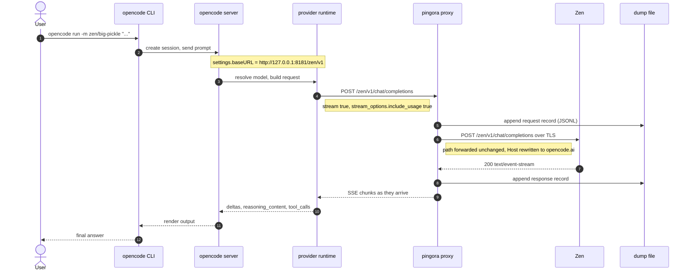
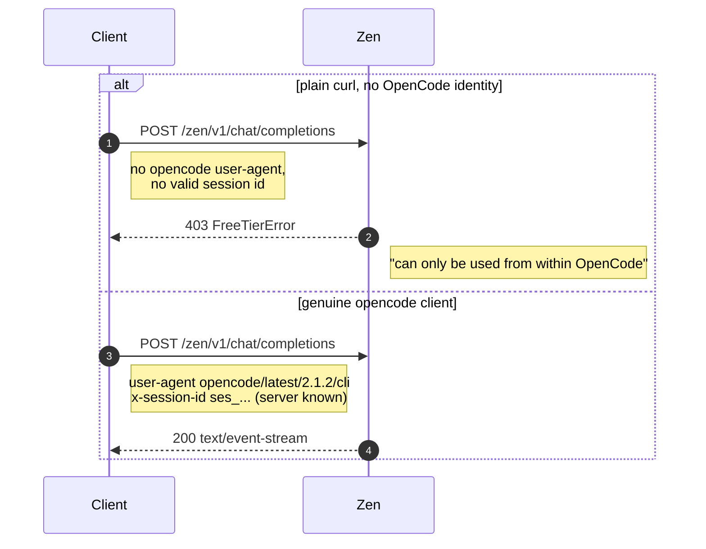
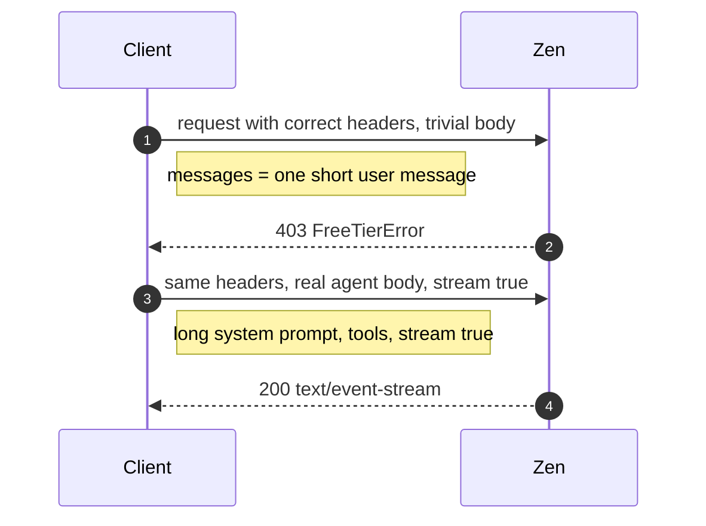
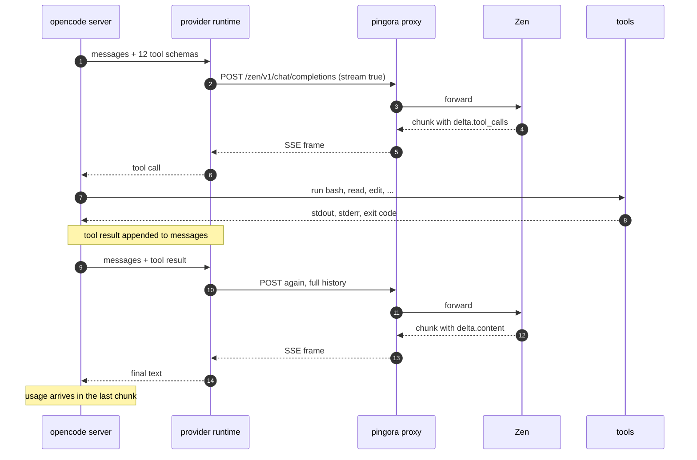
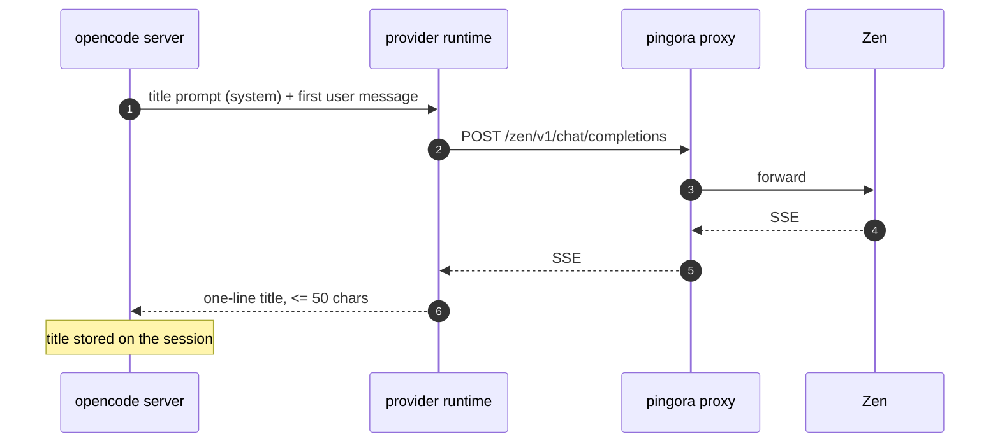
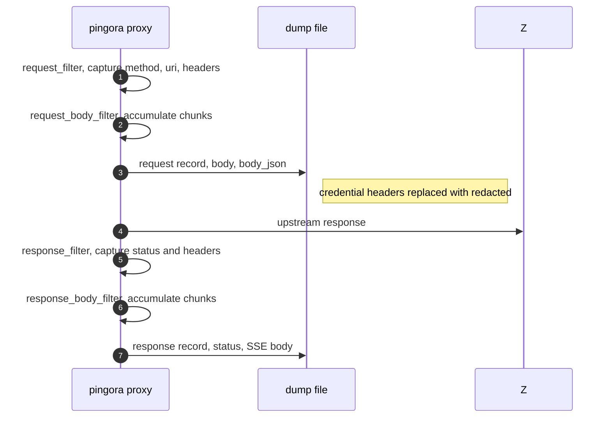

# OpenCode Zen API — research notes

Notes gathered on 2026-10-22 while wiring `opencode` through the
[pingora reverse proxy](./README.md) in this repo to reach
`https://opencode.ai/zen/v1/chat/completions`.

Everything below was verified against the live endpoints. Items marked
*(inferred)* are conclusions drawn from black-box probing, not from a
published spec.

---

## 1. Endpoints

The Zen gateway serves an OpenAI-compatible API. Paths are forwarded
unchanged, so any of these can be proxied by pointing the upstream at
`opencode.ai:443` with TLS.

| Endpoint | Purpose |
| --- | --- |
| `https://opencode.ai/zen/v1/chat/completions` | Chat completions (OpenAI-compatible, SSE streaming) |
| `https://opencode.ai/zen/v1/models` | Model list (86 models at the time of writing) |
| `https://opencode.ai/inference/v1/models` | Full model list with metadata |
| `https://opencode.ai/inference/openai/v1/chat/completions` | Console (pay-as-you-go) chat completions |
| `https://opencode.ai/inference/openai/v1/responses` | Console Responses API (GPT, Grok, Muse) |
| `https://opencode.ai/inference/anthropic/v1/messages` | Console Anthropic Messages API (Claude, Qwen) |
| `https://opencode.ai/inference/google/v1beta/models/{model}` | Console Gemini API |
| `https://opencode.ai/inference/systemone/v1/systemone` | Console Jev structured-decision API |

`/zen/v1` and `/inference/.../v1` are aliases for the same backend; both
returned identical model catalogs. `/zen/v1` is the shorter, current form.

## 2. Model catalog

`GET /zen/v1/models` returns an OpenAI-style list:

```json
{"object":"list","data":[{"id":"big-pickle","object":"model","created":1792669362,"owned_by":"opencode"}]}
```

Free models (usable without an account): `big-pickle`, `beam-free`,
`flint-40b-free`, `glm-5.3-flash-free`, `minimax-m3.1-flash-free`,
`mimo-v2.6-flash-free`, `nemotron-3.5-lightning-free`,
`nemotron-3.5-super-vl-free`, `deepseek-v4.1-flash-free`,
`jem/jev-1.13-free`, `longcat-2.5-preview-free`, `exo-free`.

Paid models require an `OPENCODE_API_KEY` from <https://opencode.ai/console>.
Pricing is per 1M tokens; `big-pickle` is currently free.

The catalog itself is published by models.dev — the `opencode` provider entry
is:

```json
{ "id": "opencode", "env": ["OPENCODE_API_KEY"],
  "npm": "@ai-sdk/openai-compatible",
  "api": "https://opencode.ai/inference/openai/v1" }
```

Fetch the raw catalog with `curl https://models.dev/api.json`.

## 3. Free-tier gating (the `403 FreeTierError`)

A bare `curl` against the free models gets:

```json
{"type":"error","error":{"type":"FreeTierError",
 "message":"OpenCode's free tier can only be used from within OpenCode. Download it at https://opencode.ai and keep building."}}
```

This is **not** an API-key check. Bisecting the headers of a real, working
`opencode` request with curl showed two conditions, both required *(inferred)*:

1. `user-agent: opencode/latest/<version>/cli` — dropping it flips 200 → 403;
   any other header in the set is individually droppable.
2. A session id the gateway recognises server-side, e.g.
   `x-session-id: ses_<32 hex chars>`. A syntactically plausible but made-up
   id (`ses_` + random hex) is rejected, so the value is validated against
   real sessions rather than by shape.

Additional observations from the bisection:

- The request body has to look like real agent traffic. The captured
  title-generator request (2.4 KB, long system prompt, `stream: true`) is
  accepted; a body of `{"model":"big-pickle","messages":[{"role":"user","content":"hi"}]}`
  is rejected with 403 even with the full correct header set.
- `stream: false` on an otherwise valid request is also rejected.
- Setting `user-agent: opencode/...` but not `opencode/latest/<ver>/cli` is
  rejected, so the version segment matters.

Practical consequence: the free tier cannot be reimplemented with curl. It
only works when traffic originates from a real OpenCode client.

## 4. OpenCode configuration (v2 schema)

The live schema is at <https://opencode.ai/config.json>. The v2 shape differs
from v1 in ways that silently break configuration.

### File locations and precedence

```
/etc/opencode/opencode.json                    # system, highest
~/.config/opencode/opencode.json               # user
<repo>/opencode.json  |  <repo>/.opencode/opencode.json   # project
```

Within a tree, `.opencode/` directories win over direct `opencode.json`
files. `opencode debug config` prints every config source that was loaded.

### The `providers` key

The key is `providers` (plural). Each entry is keyed by the provider id used
in `provider/model` references:

```jsonc
{
  "$schema": "https://opencode.ai/config.json",
  "model": "zen/big-pickle",
  "providers": {
    "zen": {
      "name": "OpenCode Zen (local proxy)",
      "package": "@opencode/ai/providers/openai-compatible",
      "settings": { "baseURL": "http://127.0.0.1:8181/zen/v1" },
      "models": {
        "big-pickle": {
          "name": "Big Pickle",
          "limit": { "context": 200000, "output": 64000 },
          "capabilities": {
            "tools": true,
            "input": ["text", "image"],
            "output": ["text"],
            "reasoning": { "supported": true }
          }
        }
      }
    }
  }
}
```

| Field | Meaning |
| --- | --- |
| `package` | Runtime package, e.g. `@opencode/ai/providers/openai-compatible` |
| `canonical` | Built-in provider id whose catalog defaults are inherited |
| `settings` | Package options — `baseURL`, `apiKey`, timeouts, `encoding`, `compaction`, `transport` |
| `headers` | Extra request headers (string values) |
| `body` | Extra JSON fields merged into every request body |
| `models` | Model overrides, keyed by the model id |

### Pitfalls found

- **`options` is not a valid key.** v1 used `provider.<id>.options`; v2 uses
  `providers.<id>.settings`. An unknown key is stripped, so the config looks
  correct in `opencode debug config` but the override never applies.
- **Malformed entries are dropped silently.** `opencode debug config` shows an
  empty `{}` for the provider and the server logs only
  `WARN configuration normalization diagnostic ... kind=invalid action="skipped malformed recognized value"`.
  Use `opencode models --standalone --print-logs --log-level debug` to see it.
  In this case the culprit was `capabilities.tool_call`; the schema wants
  `capabilities.tools`, and `capabilities.reasoning` is an object
  (`{"supported": true}`), not a boolean.
- **Overriding a built-in provider's `baseURL` does not work.** Setting
  `providers.opencode.settings.baseURL` is accepted and shown by
  `opencode debug config`, but requests still go to the catalog endpoint.
  Define a new provider id instead (this repo uses `zen`).
- **`canonical` alone is not enough.** `providers.zen.canonical = "opencode"`
  produced a provider with zero models. Listing the model explicitly is what
  makes it selectable.
- **The background server caches config.** `opencode run` talks to the
  already-running `opencode serve --service` process, which was started
  before the config file existed, so it kept using the old provider. Use
  `opencode run --standalone` for a fresh server, or `opencode service restart`.
- `settings.baseURL` is package-specific: it only has an effect when the
  selected package supports it.

### Useful CLI commands

```sh
opencode debug config                    # every config source, merged
opencode models                          # selectable provider/model pairs
opencode models --standalone             # ... in a fresh server
opencode run -m provider/model "prompt"  # non-interactive run
opencode service restart                 # restart the background server
opencode run --print-logs --log-level debug   # server logs on stderr
```

## 5. Observed wire format

Headers sent by `opencode` v2.1.2 (`user-agent: opencode/latest/2.1.2/cli`):

```
accept: */*
accept-encoding: gzip, deflate, br, zstd
b3: 28d53cc6-...-1-2408aec904781ae9
content-type: application/json
traceparent: 00-28d53cc6-...-01
user-agent: opencode/latest/2.1.2/cli
x-opencode-client: cli
x-opencode-project: <sha1 of the project>
x-opencode-session: ses_...
x-opencode-session-id: ses_...
x-session-affinity: ses_...
x-session-id: ses_...
```

Request body (title-generation call, 2.4 KB):

```json
{
  "messages": [ { "role": "system", "content": "You are a title generator. ..." },
                { "role": "user",   "content": "\"Reply with exactly: ...\"" } ],
  "model": "big-pickle",
  "stream": true,
  "stream_options": { "include_usage": true }
}
```

Request body (main agent call, 22 KB) adds `max_completion_tokens` and a
`tools` array of 12 function schemas (`edit, glob, grep, question, read,
shell, skill, subagent, webfetch, websearch, write, execute`).

Response is SSE (`content-type: text/event-stream`, `transfer-encoding: chunked`)
with `chat.completion.chunk` frames. Reasoning is returned in
`delta.reasoning_content`, not a separate event type. Zen adds an
`x-zen-model` response header and Cloudflare's `cf-ray`.

Usage arrives in the final chunk (`stream_options.include_usage`):
`{"usage":{"prompt_tokens":9303,"completion_tokens":266,"total_tokens":9569,
"prompt_tokens_details":{"cached_tokens":7818},
"completion_tokens_details":{"reasoning_tokens":171}}}`.

## 6. Proxying Zen through this repo

`conf-zen.toml` in this repo points the proxy at Zen:

```toml
[server]
listen = "127.0.0.1:8181"

[upstream]
host = "opencode.ai"
port = 443
tls = true

[dump]
file = "/tmp/opencode/zen-dump.jsonl"
max_body_bytes = 1048576
```

Start it and point `opencode` at it:

```sh
./run-zen.sh                 # 127.0.0.1:8181 -> https://opencode.ai
opencode run -m zen/big-pickle "hello"
```

The path is forwarded unchanged, so the client path `/zen/v1/chat/completions`
becomes `https://opencode.ai/zen/v1/chat/completions`.

Two build notes:

- Pingora's `openssl` feature must be enabled for TLS upstreams; with the
  default (empty) feature set, `https://` upstreams fail with `502`.
- Pingora binds with `SO_REUSEPORT`, so two proxy instances on the same port
  silently split traffic between them. Kill stale instances before restarting.

The `[dump]` section writes one JSONL record per request and per response,
including the full body — see the [Dump section of the README](./README.md).
For an agent that means the whole prompt and conversation history lands on
disk, so treat the dump file as sensitive.

## 7. Reproducing the findings

```sh
# model catalog
curl -s https://opencode.ai/zen/v1/models | jq '.data[].id'

# free tier gate: 403 FreeTierError
curl -s https://opencode.ai/zen/v1/chat/completions \
  -H 'content-type: application/json' \
  -d '{"model":"big-pickle","messages":[{"role":"user","content":"hi"}]}'

# through the proxy, with the body captured
curl -s http://127.0.0.1:8181/zen/v1/chat/completions \
  -H 'content-type: application/json' \
  -d '{"model":"big-pickle","messages":[{"role":"user","content":"hi"}]}'
jq -c 'select(.kind=="request") | {uri, body_bytes}' /tmp/opencode/zen-dump.jsonl
```

## 8. Open questions

- The exact rule the free-tier gate uses to validate a session id is not
  public. Reverse engineering further would likely break the terms of the
  free tier.
- `/zen/v1` vs `/inference/<provider>/v1` precedence is undocumented; both
  worked, and the `/inference/...` form is what the Zen docs list per model.
- Whether `x-opencode-ticket` (a header the opencode binary knows about but
  did not send) is required for paid models is untested.

## 9. How the OpenCode API works

### 9.1 The request path, end to end



The proxy is a transparent hop: it rewrites `Host`, optionally relays
`Authorization`, and by default copies everything else — including the
`user-agent` and `x-session-*` headers the free-tier gate depends on.

### 9.2 The free-tier gate





The gate is not a key check. It is satisfied only when the request looks like
it came from a real OpenCode client *and* carries a session the gateway
knows about — a made-up session id of the right shape is still rejected.

### 9.3 The agent loop

One turn of the loop is one HTTP request. The full history is resent every
time, because the endpoint is stateless.



### 9.4 The title-generator side call

The server also makes a cheap, separate call to summarise the session title.
It goes through the same provider and the same proxy, so it shows up in the
dump as an extra request/response pair.



### 9.5 What lands in the dump



A single `opencode run` therefore produces two request/response pairs in the
dump: the title call (about 2 KB) and the agent call (about 22 KB, including
the whole conversation and all tool schemas).

